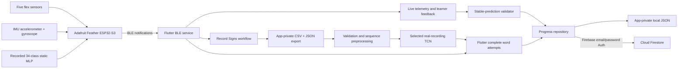
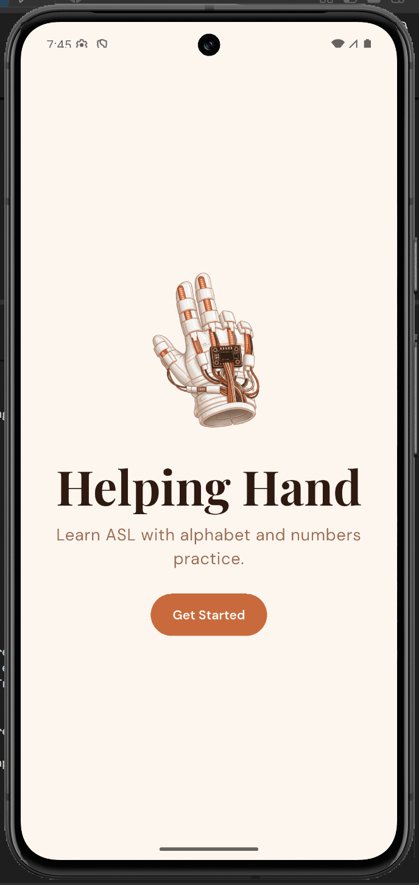
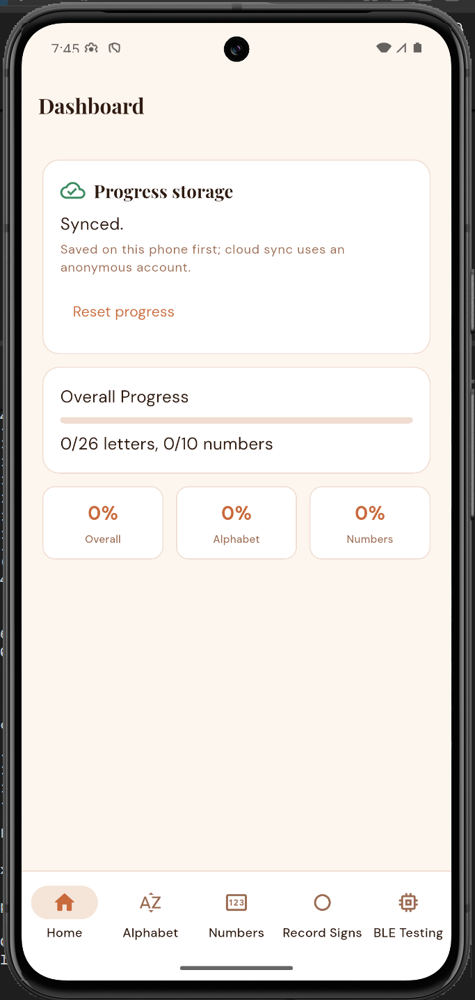
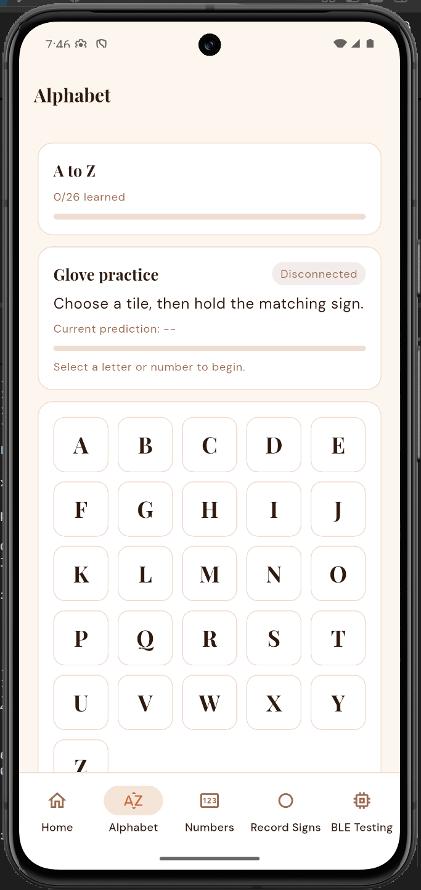
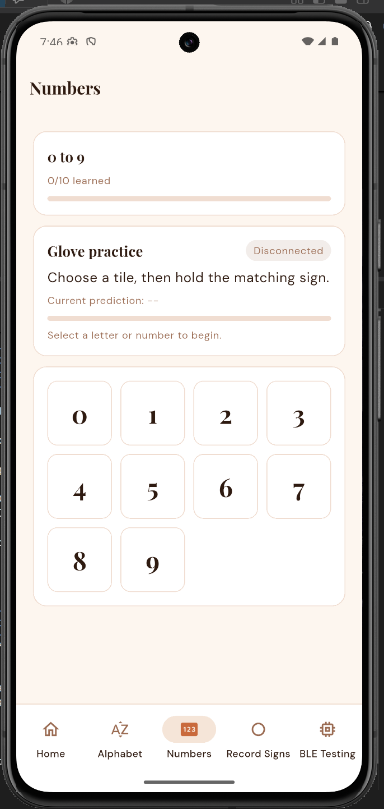
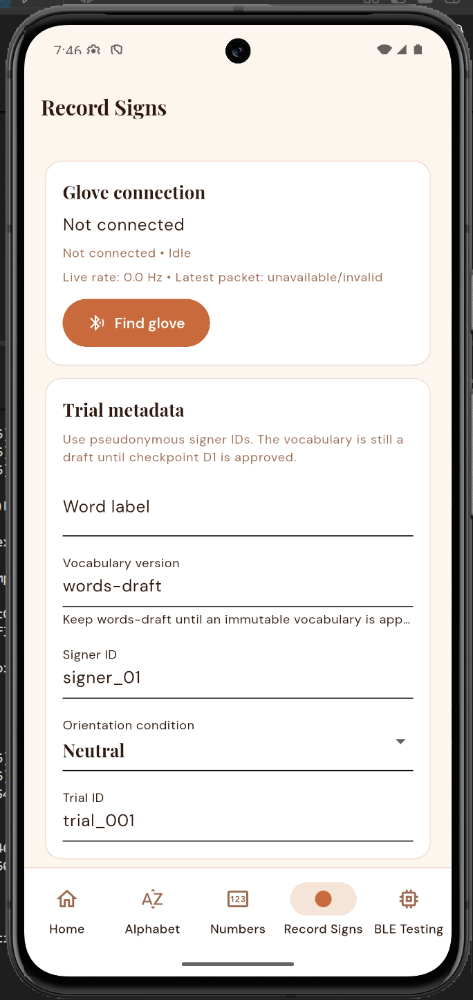
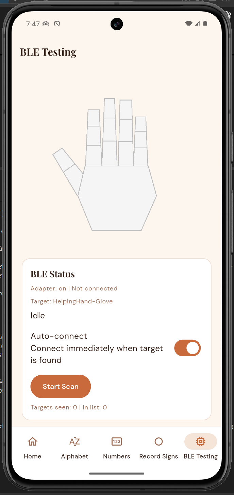
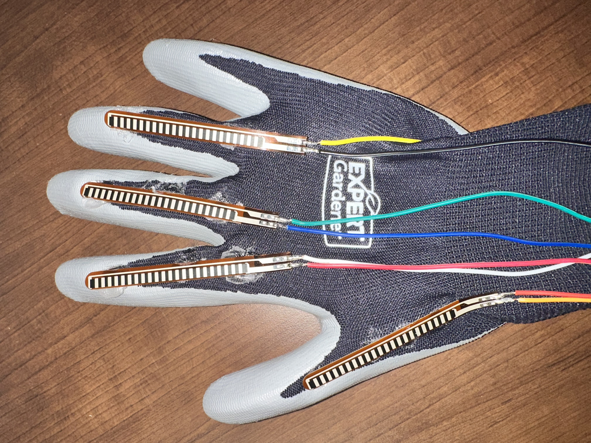

# Helping Hand - M5 Release Candidate

**Course:** CEN4908C  
**Project:** Helping Hand  
**Target milestone:** M5 Release Candidate
**Due:** October 28, 2026  
**Last updated:** October 28, 2026

Helping Hand is an American Sign Language (ASL) learning glove we are developing
for CEN4908C, Computer Engineering Senior Design. The glove measures finger bend
and wrist motion. An ESP32 processes the sensor readings and sends them over
Bluetooth Low Energy (BLE) to our Android Flutter app, where users can practice
signs, see live feedback, record gestures, and save their progress.

This repository contains our firmware, app, model-training code, hardware
documentation, and the KiCad files for our PCB design, which is still in progress.

- **Repository:** <https://github.com/GG1627/helping-hand>
- **Release candidate submission snapshot:** [`ff6a9ab`](https://github.com/GG1627/helping-hand/commit/ff6a9ab763f12f60e3a327d0df4f00a8784894b8)
- **Historical beta application snapshot:** [`d581d19`](https://github.com/GG1627/helping-hand/commit/d581d19)
- **Historical alpha validation commit:** [`cce9d38`](https://github.com/GG1627/helping-hand/commit/cce9d3887c5e52fafd4e35753f8e0de516051f79)
- **Android package:** `com.example.flutter_app`
- **Firebase project:** `helping-hand-83137`
- **Demo:** <https://www.youtube.com/shorts/qQmO1KYz998>
- **Team:** Brian, Gael, Kali, and Srinitha

## Milestone Overview

> The alpha results below are from commit `cce9d38`. Earlier beta work is
> documented in [`docs/BETA_BUILD_STATUS.md`](docs/BETA_BUILD_STATUS.md).
> The original assignments are in [`M4-Beta-Build.md`](M4-Beta-Build.md) and
> [`T2-Beta-Test-Plan.md`](T2-Beta-Test-Plan.md). Our beta work outline and test
> plan are available in [`output/pdf/M4_Beta_Build_Work_Outline.pdf`](output/pdf/M4_Beta_Build_Work_Outline.pdf)
> and [`output/pdf/T2_Beta_Test_Plan.pdf`](output/pdf/T2_Beta_Test_Plan.pdf).

Our alpha build connected the following parts of the system:

> Glove sensors → ESP32 static classifier → BLE packets → Flutter feedback
> → saved local progress → Firestore sync

As of October 27, about two of our flex sensors were broken, they were reading as flexed when they were not. We believe this is due to age. We ordered 5
Adafruit Short Flex Sensor #1070 replacements and an ICM-20948 nine-axis IMU
#4554. We still need to confirm their arrival, replace the sensors, and calibrate
the glove. Firmware support for the ICM-20948 and AK09916 magnetometer has now
been added, while keeping the older sensor path. Magnetic data is available
through serial diagnostics; orientation fusion and new-board testing are still
pending. The BLE word-model inputs remain the existing six motion values. We have also received ten piezo buzzers: one for each finger and five
in an X on the back of the hand. The firmware now sets up all ten buzzer pins
and can play a timed PWM tone on one buzzer at a time without blocking the main
loop. We still need to review the circuit, decide how each cue should work,
and test it on the glove. The app and classifier do not trigger the buzzers yet.

Since the October 6 demo, we have continued working on the KiCad schematic,
planning the board layout, and looking into ways to improve the TCN. The PCB
layout is not finished, and we have not measured an improvement in model
accuracy from this work. More details are in the
[October 27 status notes](docs/R3_REPORT_READINESS.md).
We have also begun planning on how to sew in the flex sensors and the 9-axis IMU into the glove using conductive thread and have practiced making small circuits with conductive thread to get a feel for it before adding it to our project. We plan to use multiple layers of fabric (like a PCB) to ensure that we do not short any connections.

The app includes Record Signs and a trained TCN for Hello, Please, and Yes.
Users start an attempt, perform the sign, and finish the attempt. The phone
runs the model locally and saves completion when the prediction meets the
matching and confidence requirements. Recorded replay checks passed on the
Android emulator. Fresh glove testing is **Not run**. See the
[training notes](docs/WORD_MODEL_DEMO_TRAINING.md) and
[integration guide](docs/WORD_DEMO_INTEGRATION.md).

### Release Candidate Implementation
The RC keeps the full beta feature set and adds a custom PCB design:

1. Accounts: Firebase email/password account creation, sign-in, password reset, and sign-out.
- The app opens directly to sign-in/sign-up.
- An existing anonymous session is linked to the new account so its cloud progress is kept.

2. User-scoped progress:
- Local progress files and the Firestore document users/{uid}/progress/current are scoped to the signed-in Firebase user.
- Firebase Authentication stores credentials. Raw glove recordings stay in the CSV/JSON export workflow and are never uploaded to Firebase.

3. Static recognition: the recorded 34-class model is the default. The original 36-class (A–Z, 0–9) model is kept as a regression baseline, along with the stable-prediction completion rule.

4. Dynamic word recognition: TCN inference with saved completion for Hello, Please, and Yes.

5. Custom PCB (new in M5): KiCad schematic work and board-layout planning for the ESP32-S3 and 15 resistors in the flex-sensor and piezo circuits. The board is not yet routed or fabricated.
   
6. Process documentation:
- BETA_BUILD_PLAN.md

### Current Release Candidate Learning Flow
1. The app opens to login/signup. Login, signup, and Home use text-based Helping Hand branding, and the learning screens are styled to match.
2. Alphabet and Numbers are target pickers.
3.Words is an active vocabulary picker.
4. Tapping a letter, number, or word opens a separate live-practice page. Back returns to the picker. The pickers themselves contain no practice.
Letters and numbers: a target is completed when a matching prediction at ≥80% confidence stays stable for at least 750 ms and five packets. Progress is saved per account.
5. Hello, Please, Yes:
- Tap Start attempt, perform the whole sign, then tap Finish sign.
- Completion requires the predicted word to match the target at ≥80% confidence.
6. Other words: the pages remain available with recognition marked unavailable.
  
### M5 Work and Rubric Status

| Rubric category | What we have implemented | Testing and remaining work |
| --- | --- | --- |
| Usability: Interface | Account screens, branded Home and learning screens, Alphabet/Numbers/Words selection pages, and saved progress indicators. Each target has its own practice page. | Software layout checks were completed. Accessibility checks on the intended phone and usability testing with people outside the team are **Not run**. |
| Usability: Navigation | Users can select a target, open practice, return with Back, retry an attempt, and access account and connection controls. Other word pages explain when recognition is unavailable. | Current-phone navigation checks are **Not run**. A selected static target can still complete after leaving its practice page; we still need to decide how Back should handle an active target. |
| Usability: Perception | Static practice shows prediction, confidence, hold progress, Retry, and BLE connection status. Word practice shows the predicted word and attempt result. Account and save/sync status are also visible. | We still need to check whether users understand the feedback. Buzzer pins and timed tone control are set up, but automatic corrective cues and physical feedback tests are **Not run**. |
| Usability: Responsiveness | BLE and Firebase work asynchronously, Firebase starts when needed, and word inference runs in a background isolate. Buzzer timing is checked in the main loop without a blocking delay. | Latency on the intended phone and sustained BLE streaming measurements are **Not run**. |
| Build Quality: Robustness | We kept the original static model for regression checks. Word attempts check packet validity and timing and are canceled on disconnect, Back, or backgrounding. Progress is saved locally before cloud sync. | Earlier word integration passed 42 focused Flutter checks, three native Android recorded replay checks, and a debug APK build. Current repaired-glove regression, stress testing, and full account/offline tests are **Not run**. |
| Build Quality: Consistency | Static completion requires a matching prediction at 80% confidence or higher for at least 750 ms and five packets. Hello/Please/Yes use Start attempt / Finish sign and require the top predicted word to match at 80% confidence or higher. Progress is saved per account. | Repeatability across wearers and wrist angles, unrelated-motion rejection, and live account-isolation checks are **Not run**. The word model has no rest/unknown class. |
| Build Quality: Aesthetic Rigor | Login, signup, Home, and learning screens share the Helping Hand text branding, colors, and fonts. Practice pages use matching controls and feedback. We are also planning the PCB layout and how to sew the sensors into the glove. | Software visual/layout checks were completed. The PCB layout and sewn assembly are still in progress; final glove appearance, fit, and comfort tests are **Not run**. |

### Historical Beta Feature Status

| Area | What we added | Testing and remaining work |
| --- | --- | --- |
| Accounts | Firebase email/password signup, sign-in, password reset, and sign-out. Creating an account can link the existing anonymous account to keep its progress. | We reported signup and sign-in working, but did not record the exact build/device or complete all account tests. |
| Learning interface | Matching branding and colors, Alphabet/Numbers/Words selection pages, separate practice pages, and Back navigation. | Targeted code analysis and visual/software checks were completed. Current-phone navigation and usability tests with people outside the team are Not run. |
| Static recognition | A recorded 34-class MLP runs on the ESP32 by default. We kept the original synthetic 36-class model for comparison. | The recorded model excludes J/Z. Held-out recordings were evaluated for A, B, 1, and 3 only, so these results do not show accuracy across all classes or on fresh live attempts. See the [static model notes](docs/STATIC_MLP_DEMO_MODEL.md). |
| Word training | We compared TCN, CNN-GRU, and CNN-LSTM on 15 Hello/Please/Yes trials. Each model used the same nine training, three validation, and three test trials, with no trial split between sets. | All three models got 3/3 validation trials correct. TCN was selected because it was smallest and got 3/3 reserved test trials correct. The recordings came from one reported wearer at a neutral wrist angle, so we still need broader testing. |
| Word practice | The app runs the 48,324-byte TCN locally using Start attempt / Finish sign. Completion requires the top prediction to match the selected word at 80% confidence or higher. | 42 focused Flutter checks, three native Android recorded replay checks, and a debug APK build passed. Fresh glove recognition and latency on the intended phone are Not run. |
| Progress | Progress is saved locally for each user and synced to Firestore. Word completion uses the existing completed-exercise field. | We still need full app tests for word sync, restarting, switching accounts, offline recovery, and using another device. |
| Recording and preprocessing | Users can review complete trials, save or discard them, and export CSV/JSON files. Preprocessing resamples using device timestamps and fits standardization on training data only. | Raw recordings are stored separately from Firebase progress. We need more repetitions, wearers, and wrist angles. |
| Hardware feedback | We kept the existing flex/accelerometer/gyroscope BLE connection. Haptics were not integrated in the beta. | The later repair, IMU, buzzer, and PCB work is still in progress; ordering or receiving parts does not mean they have been integrated. |

### Historical Alpha Feature Status

| Area | Alpha status | Testing and limitations |
| --- | --- | --- |
| ESP32 sensor runtime | Implemented; September build passed | Reads five flex inputs and six accelerometer/gyroscope values and emits structured BLE packets. |
| Static sign classification | Implemented; tested on the earlier glove | The alpha build’s embedded 36-class TFLite MLP predicts `A`–`Z` and `0`–`9` from flex inputs. The team demonstrated glove-to-phone prediction and confidence output at the end of the previous semester. |
| BLE interface | Implemented; tested on the earlier glove | The app scans for `HelpingHand-Glove`, connects, subscribes to notifications, parses packets, and handles disconnect/reconnect states. Historical videos below show physical glove/sensor data reaching the phone. |
| Learner practice | Implemented; automated checks passed | A tile selects a target. Progress is awarded only after a matching prediction at or above 80% confidence remains stable for at least 750 ms and five packets. |
| Persistent progress | Implemented; automated checks passed | Learned letters, learned numbers, and completed exercises are saved locally first and synchronized to Firestore through anonymous authentication. |
| Record Signs | Implemented; pilot recording collected | The simplified static-sign flow selects a letter/number, counts down for three seconds, records live packets, and saves/exports CSV/JSON. A real-device pilot export is preserved in `backend/recorded_data/`; it is not model evidence because it has one signer and mostly one trial per label. |
| Word preprocessing | Implemented; automated checks passed | Schema validation, quality reports, fixed-rate resampling, fixed windows, deterministic splits, and train-only standardization are present. |
| Dynamic word models | Architecture foundation only | TCN, CNN-GRU, and CNN-LSTM candidates build and convert in software tests, but no real-data word training had been completed at that alpha snapshot. |
| Glove haptics | Research/design direction only | Research recommends beginning with small LRA actuators and a closed-loop driver. No haptic circuit, firmware command path, or physical validation existed at that alpha snapshot. |

### Historical Beta Rubric Traceability

| M4 requirement | What we implemented | What still needs testing or completion |
| --- | --- | --- |
| Usability, interface, and navigation | Matching account and learning screens, target selection, separate practice pages, Back, Retry, and progress indicators. | Current-phone control tests and usability sessions with people outside the team are Not run. |
| Perception | Connection status, predictions, confidence, hold progress, word results, and save/sync status are shown near the relevant controls. | We still need to check whether users understand the feedback. Haptics were not integrated in the beta. |
| Responsiveness | BLE and Firebase work asynchronously, and word inference runs in a background isolate. | Phone latency and sustained streaming measurements are Not run. |
| Robustness and consistency | A shared BLE service, stable static-match rules, word recording/cancellation checks, and software regression checks. | Hardware edge cases, stress tests, rejection of unrelated motion, and static completion after Back still need work or testing. |
| Aesthetic rigor | Consistent branding, bundled fonts, matching learning pages, and software layout checks. | On-device accessibility and glove appearance/comfort tests are Not run. |
| External interface | Account, practice, recording, and progress controls connect to the app services. | Word recognition supports Hello/Please/Yes only. Sign-specific instructional media and haptic feedback are incomplete. |
| Persistent state | Successful practice updates each user's local JSON progress and authenticated Firestore document. | We still need full tests for account separation, offline recovery, restoring progress after restart, and word sync. |
| Internal systems | The ESP32 runs static recognition, Flutter runs the TCN, and the backend handles sequence validation, training, and export. | More wearer/wrist-angle testing, calibration after repairs, and fresh glove-to-phone tests are pending. |
| Submission and effort evidence | Git history, training/integration notes, and beta work-outline/test-plan files record our work. | These files alone do not show that the M4 report, stakeholder defense, or every rubric requirement is complete. |

### Historical Alpha Rubric Traceability

| Alpha requirement | Helping Hand implementation |
| --- | --- |
| Usability and user control | Clearly labeled navigation, BLE scan/connect controls, learner target selection, retry/reset controls, and explicit recording save/discard/export actions. |
| Interface and navigation | Five persistent bottom-navigation destinations: Dashboard, Alphabet, Numbers, Record Signs, and BLE Testing. |
| Perception and feedback | Connection, prediction, confidence, hold progress, success/retry, recording quality, local-save, synchronization, offline, and failure states appear near the action they describe. |
| Responsiveness | BLE and Firebase work is asynchronous. Firebase initialization is lazy and cannot block application launch or local progress access. |
| Build quality and robustness | Flutter analysis, Flutter tests, Android APK build, ESP32 build, and the complete backend test suite pass on the validation environment documented below. |
| Vertical feature | The static learner loop connects physical sensor input, embedded inference, BLE transport, mobile feedback, and persistent learner state. |
| Persistent state | Progress is written to app-private local storage first and optionally synchronized to an authenticated, user-owned Firestore document. |
| Internal processing | The ESP32 performs static TFLite inference; Flutter validates stable predictions; the backend validates and prepares dynamic word sequences. |


### Architecture



### Embedded Runtime

The firmware runs on the Adafruit Feather ESP32-S3 in
[`ESP32/src/main.cpp`](ESP32/src/main.cpp). It reads five flex sensors on
A0–A4 and communicates with the IMU over I2C (SDA=3, SCL=4).
[`imu_sensor.cpp`](ESP32/src/imu_sensor.cpp) now checks both 0x68 and 0x69 for
supported MPU-style parts or the new ICM-20948. The ICM path uses its own banked
register map, sets +/-2 g and +/-250 degrees/second ranges, and reads the
AK09916 magnetometer through I2C bypass. Compass data is checked for readiness
and overflow and reported in uncalibrated microteslas through serial diagnostics.
A read failure in the motion sensor marks it offline and enables discovery retries.
If the compass is unavailable, acceleration/gyro streaming can still continue.

BLE still sends the existing ax/ay/az in g and gx/gy/gz in degrees/second.
The current word model still uses five flex and six motion inputs; the new
magnetic readings do not change its input shape. Magnetic calibration,
axis alignment, fusion, and recognition on the replacement hardware still need
testing. The firmware changes are checked against the
[TDK datasheet](https://product.tdk.com/system/files/dam/doc/product/sensor/mortion-inertial/imu/data_sheet/ds-000189-icm-20948-v1.5.pdf).

The default static model is the recorded 34-class MLP; the original synthetic
36-class model is kept for regression checks. Firmware sends predictions and
confidence over BLE as `HelpingHand-Glove` and resumes advertising after a
disconnect. The configured stream rate is 40 Hz (adjustable to 25–50 Hz).
Phone-side rate and packet loss still need measurement.

The planned PCB schematic includes the ESP32-S3 and 15 resistors for the flex
and piezo circuits. Placement, routing, fabrication, and board testing are not
complete. The proposed sewn glove uses five fabric layers total: inner liner,
first routing fabric, insulating separator, second routing fabric, and outer
cover. This separates two routing levels; final routing and movement tests must
confirm whether more local insulation is needed. See
[`M5_Work_Outline.md`](M5_Work_Outline.md) for the assembly plan and references.

Host-side simulated-I2C regression checks passed; run
`python3 ESP32/test/imu_host_test.py` with Python 3 and `g++`.
The full build attempt timed out during installation of the missing
`tool-openocd-esp32` package, so board compilation is not confirmed. New IMU
bring-up, compass calibration, and sewn-glove testing are **Not run**.

The buzzers are outputs. [`piezo.cpp`](ESP32/src/piezo.cpp) sets all ten pins LOW
before waiting for the serial connection. `startPiezo(output, frequencyHz,
durationMs)` plays one tone at 50% duty cycle. `updatePiezos()` stops it from
the main loop when its time is up, and `stopPiezos()` cancels it early.

The code rejects requests before setup, while another buzzer is active, or with
an invalid output, frequency, or duration. It accepts 20–20,000 Hz and
1–5,000 ms; these are code limits, not confirmed ratings for our buzzers. One
LEDC channel is used for the selected pin, so only one buzzer can play at a
time. We still need to choose a frequency for the actual piezo and driver.
The buzzers stay off at startup and are not connected to app/classifier cues yet.

| Buzzer position | Feather pin label | ESP32-S3 GPIO |
| --- | --- | --- |
| Thumb | A5 | 8 |
| Index / pointer | D5 | 5 |
| Middle finger | D6 | 6 |
| Ring finger | D9 | 9 |
| Pinky | D10 | 10 |
| Hand matrix left | SCK | 36 |
| Hand matrix right | MISO | 37 |
| Hand matrix center | D12 | 12 |
| Hand matrix up | D11 | 11 |
| Hand matrix down | MOSI | 35 |

These pins come from the resistor names and board labels in
`pcb/pcb.kicad_sch`, checked against the Feather pin definitions. Left, right,
center, up, and down describe the buzzer positions; we have not tested them as
directional cues yet. SCK/MISO/MOSI are used as buzzer outputs here, so they
cannot also be used for SPI at the same time. Compile-time checks catch repeated
pins and conflicts with the flex or I2C pins. Physical buzzer output, how the
cues feel/sound, driver suitability, and timing while BLE is running are
**Not run**.

### Flutter Application
The Android Flutter app is in flutter_app/.

- Shared BLE service: owns scanning, connection, notification subscription, packet parsing, and reconnect behavior. Learner practice, Record Signs, and BLE Testing all consume the same packet stream.
- Authentication: Firebase email/password accounts gate entry to the app.
- Letter/number practice: tapping a target opens its practice page. Selecting a target does not mark it learned. The app requires a stable classifier match before saving completion, and shows the target, current prediction, confidence, connection state, hold progress, and success/retry messages.
- Word practice: the learner delimits each attempt with Start attempt / Finish sign. The TCN classifies the complete attempt locally on the phone.

### Local and Firebase Persistence
Progress uses a local-first repository design:

- The app loads the signed-in user's progress file from app-private application-support storage.
- Progress is written locally before cloud synchronization begins.
- Firebase initializes on demand rather than before runApp().
- Firebase email/password authentication provides the user identity. The alpha used anonymous authentication.
- The progress document syncs at users/{uid}/progress/current.
- Firestore rules allow an authenticated user to read and write only their own fixed progress document. Collection listing and document deletion are denied.
- If Firebase is unavailable, the app continues with its local copy and offers a retry action.

The document contains only:

schema version
learned letters
learned numbers
completed exercise identifiers
an update timestamp

Raw glove recordings are never uploaded to Firebase. The UI exposes loading, saved locally, syncing, synced, offline/local-only, and failure states. Malformed local state falls back to a safe empty representation rather than crashing.

### Word-Recording and ML Foundation
Record Signs creates labeled trials using the word-sequence-v1 contract.

- Word captures use Stop → review → Save trial / Discard trial.
- Each saved row keeps:
     - the exact BLE packet
     - parsed timestamps and sequence number
     - five flex readings and six IMU readings
     - label, pseudonymous signer ID, orientation, and trial metadata
- Sessions stay app-private until exported as CSV/JSON through the Android share sheet.

The backend can:

- validate columns, values, labels, metadata, sequence order, timestamps, rate, and sensor ranges;
- report malformed packets and gaps without repairing raw evidence;
- resample trials and create fixed-length windows;
- make deterministic splits that keep each trial and signer within one split;
- fit standardization on training data only;
- evaluate top-1 and top-5 accuracy, macro F1, confusion matrices, and signer/orientation groups;
- build and smoke-test TCN, CNN-GRU, and CNN-LSTM candidates with float TFLite conversion.

Synthetic fixtures are software-test data only and are marked non-reportable. The deployed TCN currently covers Hello, Please, and Yes. It was trained on recordings from a single wearer in a neutral orientation and has no rest/unknown class.

## Application Evidence

The following screenshots were captured from the current Android emulator
build. The glove had been disassembled for the next hardware iteration during
the summer, so the learner, recording, and BLE screenshots intentionally show
the disconnected state. They demonstrate the current interface and navigation,
not a current physical-glove connection. The Dashboard screenshot records the
app reaching its `Synced` progress-storage state.

<table>
  <tr>
    <td align="center"><br><strong>Start</strong></td>
    <td align="center"><br><strong>Dashboard and sync</strong></td>
    <td align="center"><br><strong>Alphabet practice</strong></td>
  </tr>
  <tr>
    <td align="center"><br><strong>Number practice</strong></td>
    <td align="center"><br><strong>Record Signs</strong></td>
    <td align="center"><br><strong>BLE Testing</strong></td>
  </tr>
</table>

### Historical Physical Integration Evidence

These short videos were recorded at the end of the previous development
semester. They establish that real flex-sensor changes reached the physical
Android phone over BLE and changed the live hand visualization. The team's
end-of-semester integration testing also displayed the static classifier's
predicted sign and confidence on the phone.

- [Bench flex sensor streaming to the phone (6 seconds)](app_glove_pictures_and_vids/vid-1.mp4)
- [Wearable glove connected to the phone (8 seconds)](app_glove_pictures_and_vids/vid-2.mp4)

<p align="center">
  
</p>

The videos are historical validation of the glove/BLE baseline. The current
Firebase persistence, stable-prediction completion logic, and Record Signs
workflow were validated through the current automated tests and emulator build;
they were not present in exactly this form in the historical video.

## Release Candidate Navigation and Use

### 1. Start and Dashboard

1. Launch the app and create an account or sign in with email and password.
2. Home loads the signed-in user's local progress copy.
3. The Progress storage card reports whether data is loading, saved locally,
   syncing, synced, offline, or failed.
4. **Retry sync** appears when remote synchronization is unavailable.
5. **Reset progress** requires confirmation before clearing progress locally
   and synchronizing the empty state.

### 2. Connect the glove

1. Power the flashed ESP32 glove.
2. Enable Bluetooth and grant the Android permissions requested by the app.
3. Open **Developer Mode > BLE Testing** and select **Start Scan**, or select **Find glove** from
   Record Signs.
4. The app targets the advertised name `HelpingHand-Glove` and can auto-connect
   when it appears.
5. A connected status and incoming values indicate a successful notification
   subscription.

### 3. Complete a learner item

1. Open **Alphabet** or **Numbers**.
2. Select one target tile to open its practice page. The current default
   recorded static model supports 0–9 and letters except J/Z.
3. Form the matching static sign with the connected glove.
4. Hold the matching prediction at 80% confidence or higher for at least
   750 ms and five packets.
5. The interface displays hold progress, `correct`, `try again`, low-confidence,
   and disconnected states near the exercise.
6. After success, the item is marked learned and saved through the progress
   repository.

### 4. Record a word trial

To practice an already trained word, open Words > Hello, Please, or Yes, tap
Start attempt, perform the complete sign, then Finish sign. A matching result
at 80% confidence or above saves completion. See
[the word demo guide](docs/WORD_DEMO_INTEGRATION.md) for timing and rehearsal.
The steps below collect additional training recordings.

1. Open **Record Signs** and connect the glove.
2. Enter a lowercase word label, vocabulary version, pseudonymous signer ID,
   orientation condition, and unique trial ID.
3. Wait for a complete, fresh packet and select **Start recording**.
4. Perform one complete gesture, then stop and review duration, packet count,
   delivered rate, valid packets, and warnings.
5. Save a clean trial or discard it with a reason.
6. Export the selected session's CSV and JSON through the share sheet.

Use pseudonymous IDs such as `signer_01`. Never enter a participant's name or
email address, upload raw recordings to Firebase, or commit participant
recordings to Git.

## Prerequisites

The documented alpha validation environment on Windows used:

- Git;
- Flutter `3.41.6` stable and Dart `3.11.4`;
- Android Studio/Android SDK and an Android emulator or physical Android phone;
- a Java installation supported by the installed Flutter/Android toolchain;
- Python `3.10.11` for the complete TensorFlow backend suite;
- TensorFlow `2.21.0` and pytest `9.1.1`; and
- PlatformIO Core `6.1.19`.

A physical Android device is required for meaningful BLE validation. An
emulator can validate navigation, local persistence, and Firebase behavior but
does not represent real glove discovery or sensor streaming.

## Clone the repository

```powershell
git clone https://github.com/GG1627/helping-hand.git
cd helping-hand
```

If the repository is private, the project owner must grant the instructors
access before submission.

## Build and run the Flutter app

```powershell
cd flutter_app
flutter pub get
flutter analyze
flutter test
flutter build apk --debug
flutter devices
flutter run -d <android-device-id>
```

The debug APK is generated at:

```text
flutter_app/build/app/outputs/flutter-apk/app-debug.apk
```

The Android Firebase client configuration targets the project listed above.
Running the app does not require a service-account key. Use a team-provided
test account; do not put credentials in this repository. The current application
provides email/password account creation and sign-in. The older alpha used
anonymous authentication; that historical behavior is not the current account
flow.

For project maintainers only, Firestore rules are defined in
[`flutter_app/firestore.rules`](flutter_app/firestore.rules). Always verify the
selected Firebase project before deployment:

```powershell
cd flutter_app
npx firebase-tools use helping-hand-83137
npx firebase-tools use
npx firebase-tools deploy --only firestore --project helping-hand-83137
```

Do not deploy open/test-mode rules, create service-account keys for the mobile
app, or select any unrelated Firebase project.

## Build, upload, and monitor the ESP32 firmware

Install PlatformIO if it is not already available:

```powershell
py -3.10 -m pip install platformio
```

Build the firmware:

```powershell
cd ESP32
platformio run
```

Connect the Feather ESP32-S3, identify its serial port, then upload and monitor:

```powershell
platformio run --target upload --upload-port <COM-port>
platformio device monitor --baud 115200 --port <COM-port>
```

Expected output includes BLE advertising status and telemetry beginning with
`seq=...`, `t_ms=...`, and sensor fields. Hard-coded ML test mode is disabled in
the submitted source; normal packets use live flex readings.

The target recording rate can be changed at compile time to an integer from 25
through 50 Hz with `HH_SENSOR_RATE_HZ`. The default is 40 Hz.

## Set up and test the backend

Create a clean Python 3.10 environment from the repository root:

```powershell
py -3.10 -m venv .venv
.\.venv\Scripts\python.exe -m pip install --upgrade pip
.\.venv\Scripts\python.exe -m pip install -r requirements.txt
.\.venv\Scripts\python.exe -m pytest backend/tests -q
```

Validate a real exported Record Signs session without editing it:

```powershell
.\.venv\Scripts\python.exe backend/prepare_word_sequences.py path/to/trials.csv
```

The model-development entry points support further training and evaluation.
The three-word demo is already trained; broader recognition requires more
real recordings and an evaluation protocol appropriate to the expanded scope:

```powershell
.\.venv\Scripts\python.exe backend/train_word_models.py --help
.\.venv\Scripts\python.exe backend/evaluate_word_models.py --help
```

See [`backend/data/README.md`](backend/data/README.md) for the schema and
privacy contract and [`backend/models/README.md`](backend/models/README.md) for
the model artifact policy.

## BLE packet contract

The firmware and app share Nordic UART-style service and characteristic UUIDs.
Each complete notification contains a monotonically increasing sequence ID,
device uptime, IMU identity, six motion values, static prediction and
confidence, and five raw/normalized flex readings:

```text
seq=...,t_ms=...,who=0xNN,
ax=...,ay=...,az=...,gx=...,gy=...,gz=...,
expected=...,pred=...,pred_conf=...,
flex0_raw=...,flex0_norm=...,...,flex4_raw=...,flex4_norm=...
```

Malformed notifications are retained by the recording path with their original
packet text and are marked invalid rather than silently repaired.

## Historical Alpha Validation Results

These commands were run on **September 10, 2026** against implementation commit
`cce9d3887c5e52fafd4e35753f8e0de516051f79`:

| Validation | Result |
| --- | --- |
| `flutter analyze` | Passed — no issues found |
| `flutter test` | Passed — all 16 tests |
| `flutter build apk --debug` | Passed — debug APK produced |
| `platformio run` in `ESP32/` | Passed for `adafruit_feather_esp32s3` |
| ESP32 memory report | 37.6% RAM and 83.9% of configured application flash |
| Complete `pytest backend/tests -q` with TensorFlow installed | Passed — 23 tests; 3 non-failing TFLite interpreter deprecation warnings |
| Firebase environment | Correct alpha project verified; Anonymous Authentication enabled; Firestore available |
| Firestore rules | Deployed and read back; authenticated owner-only fixed progress document; no open/test-mode access |
| Historical alpha emulator run | Dashboard reached `Synced` in the September evidence |
| Historical physical run | Glove/flex data reached a physical Android phone over BLE and changed the live visualization; static predictions and confidence were demonstrated by the team |

These results show what passed on the September build. We still need to test
the current software on the repaired glove. The older videos show the earlier
glove-to-phone connection; that glove was unavailable for another test when
the screenshots were taken.

## Repository layout

| Path | Purpose |
| --- | --- |
| [`ESP32/`](ESP32/) | Feather ESP32-S3 firmware, static model header, and IMU diagnostics |
| [`flutter_app/`](flutter_app/) | Android Flutter application, BLE client, learner loop, recording, local persistence, Firebase sync, and tests |
| [`pcb/`](pcb/) | In-progress KiCad schematic and board-design files for the planned glove PCB. |
| [`backend/`](backend/) | Static artifacts, word-sequence validation/preprocessing, candidate training/selection/export, and tests |
| [`docs/`](docs/) | Word-data collection and project documentation |
| [`research/`](research/) | Word-level IMU recognition and haptic-feedback research |
| [`app_glove_pictures_and_vids/`](app_glove_pictures_and_vids/) | Earlier emulator screenshots and historical physical integration evidence |
| [`hardware_pictures/`](hardware_pictures/) | Assembly and soldering photographs |
| [`design_draft/`](design_draft/) | Original design document, Figma concepts, storyboard, networking diagram, and legacy schematic draft |
| [`PLAN.md`](PLAN.md) | Living dynamic-word implementation plan |
| [`ALPHA_BUILD_PLAN.md`](ALPHA_BUILD_PLAN.md) | Deadline-oriented alpha planning and acceptance checklist |
| [`BETA_BUILD_PLAN.md`](BETA_BUILD_PLAN.md) | Beta implementation summary, architecture, historical evidence, and known limitations |

### Hardware documentation note

The schematic in `design_draft/schematic/` is our original ESP32-C3/LSM9DS1
concept, so it does not show the Feather ESP32-S3 glove wiring. Refer to the
firmware pin definitions and hardware photos for the alpha setup. Our current
KiCad schematic is
[`pcb/pcb.kicad_sch`](pcb/pcb.kicad_sch), with board-design files under `pcb/`.

## Known Bugs and Incomplete Release Candidate Features

1. ESP32 firmware startup - ESP32/src/main.cpp waits for the USB Serial interface with no timeout. If no serial host opens the port, setup can stay blocked before BLE and sensor initialization.

2. Flutter practice lifecycle -	A selected letter or number stays active after leaving its practice page. The app shell keeps accepting matching packets and can record completion while the learner is on the picker.

3. Issues with the BLE connection + Power.

4. The flex sensors are bent so the readings are off meaning the ML prediction is incorrect - Purchased new sensors.

   
## AI-Assisted Development Disclosure
We used approved generative AI tools to help with parts of the research,
planning, code, testing, and documentation, following the
[course AI-use policy](ai-policy/AI-USAGE.md). AI-assisted commits include
`GENAI=Yes` in the subject and an `AI-Assisted` trailer. Our team is responsible
for reviewing, understanding, testing, and presenting the submitted work.
