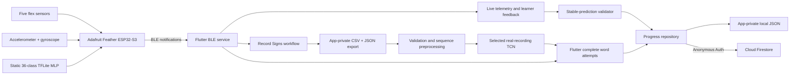

# Helping Hand - M5 Release Candidate

**Course:** CEN4908C  
**Project:** Helping Hand  
**Target milestone:** M5 Release Candidate
**Due:** October 28, 2026  
**Last updated:** October 28, 2026

Helping Hand is a wearable-assisted American SIgn Language (ASL) learning system developed for our course, CEN4908C (Computer Engineering Senior Design). The glove captures finger bend and wrist motion data, an ESP32 processes the signals from the sensors and sends them over Bluetooth Low Energy (BLE), and lastly an Android Flutter app provides live feedback, guided practice, recording tools, and persistent learner progress.

The following repository contains the Helping Hand source code (firmware and software), hardware documentation, and PCB files.

- **Repository:** <https://github.com/GG1627/helping-hand>
- **Current release candidate application snapshot:** ['']()
- **Historical beta validation commit:** [`d581d19`](https://github.com/GG1627/helping-hand/commit/d581d19)
- **Historical alpha validation commit:** [`cce9d38`](https://github.com/GG1627/helping-hand/commit/cce9d3887c5e52fafd4e35753f8e0de516051f79)
- **Android package:** `com.example.flutter_app`
- **Firebase project:** `helping-hand-83137`
- **Team:** Brian, Gael, Kali, and Srinitha

## Milestone Overview

> The alpha details and validation results below refer specifically to commit
> `cce9d38`. Current beta scope and known limitations are summarized here and in
> [`docs/BETA_BUILD_STATUS.md`](docs/BETA_BUILD_STATUS.md). The course prompts
> are preserved in [`M4-Beta-Build.md`](M4-Beta-Build.md) and
> [`T2-Beta-Test-Plan.md`](T2-Beta-Test-Plan.md). The current report and test
> work outline and test plan are [`output/pdf/M4_Beta_Build_Work_Outline.pdf`](output/pdf/M4_Beta_Build_Work_Outline.pdf)
> and [`output/pdf/T2_Beta_Test_Plan.pdf`](output/pdf/T2_Beta_Test_Plan.pdf).

The completed alpha path is:

> Glove sensors → ESP32 static classifier → BLE packets → Flutter learner
> feedback → local progress → authenticated Firestore synchronization

The app also contains a Record Signs workflow and a trained TCN for Hello,
Please, and Yes. Flutter performs word inference locally on complete,
user-delimited attempts and saves successful word completion. Android emulator
replay passed; fresh physical-glove validation remains Not run. See the
[training record](docs/WORD_MODEL_DEMO_TRAINING.md) and
[integration instructions](docs/WORD_DEMO_INTEGRATION.md).

### Release Candidate Implementation

### Current Release Candidate Learning Flow

### M5 Work and Rubric Status

### Historical Beta Feature Status

### Historical Alpha Feature Status
| Area | Alpha status | Evidence and boundary |
| --- | --- | --- |
| ESP32 sensor runtime | Implemented; current source builds | Reads five flex inputs and six accelerometer/gyroscope values and emits structured BLE packets. |
| Static sign classification | Implemented; historically physically validated | The embedded 36-class TFLite MLP predicts `A`–`Z` and `0`–`9` from flex inputs. The team demonstrated glove-to-phone prediction and confidence output at the end of the previous semester. |
| BLE interface | Implemented; historically physically validated | The app scans for `HelpingHand-Glove`, connects, subscribes to notifications, parses packets, and handles disconnect/reconnect states. Historical videos below show physical glove/sensor data reaching the phone. |
| Learner practice | Implemented and automated-test validated | A tile selects a target. Progress is awarded only after a matching prediction at or above 80% confidence remains stable for at least 750 ms and five packets. |
| Persistent progress | Implemented and automated-test validated | Learned letters, learned numbers, and completed exercises are saved locally first and synchronized to Firestore through anonymous authentication. |
| Record Signs | Implemented; pilot physically exercised | The simplified static-sign flow selects a letter/number, counts down for three seconds, records live packets, and saves/exports CSV/JSON. A real-device pilot export is preserved in `backend/recorded_data/`; it is not model evidence because it has one signer and mostly one trial per label. |
| Word preprocessing | Implemented and automated-test validated | Schema validation, quality reports, fixed-rate resampling, fixed windows, deterministic splits, and train-only standardization are present. |
| Dynamic word models | Architecture foundation only | TCN, CNN-GRU, and CNN-LSTM candidates build and convert in software tests, but none has been trained or evaluated on a real Helping Hand word dataset. |
| Glove haptics | Research/design direction only | Research recommends beginning with small LRA actuators and a closed-loop driver. No haptic circuit, firmware command path, or physical validation exists yet. |

### Historical Beta Rubric Traceablitiy

### Historical Alpha Rubric Traceability

| Alpha requirement | Helping Hand implementation |
| --- | --- |
| Usability and user control | Clearly labeled navigation, BLE scan/connect controls, learner target selection, retry/reset controls, and explicit recording save/discard/export actions. |
| Interface and navigation | Five persistent bottom-navigation destinations: Dashboard, Alphabet, Numbers, Record Signs, and BLE Testing. |
| Perception and feedback | Connection, prediction, confidence, hold progress, success/retry, recording quality, local-save, synchronization, offline, and failure states appear near the action they describe. |
| Responsiveness | BLE and Firebase work is asynchronous. Firebase initialization is lazy and cannot block application launch or local progress access. |
| Build quality and robustness | Flutter analysis, Flutter tests, Android APK build, ESP32 build, and the complete backend test suite pass on the validation environment documented below. |
| Vertical feature | The static learner loop connects physical sensor input, embedded inference, BLE transport, mobile feedback, and persistent learner state. |
| Persistent state | Progress is written to app-private local storage first and optionally synchronized to an authenticated, user-owned Firestore document. |
| Internal processing | The ESP32 performs static TFLite inference; Flutter validates stable predictions; the backend validates and prepares dynamic word sequences. |


### Architecture



### Embedded Runtime

### Flutter Application

### Local and Firebase Persistence

### Word-Recording and ML Foundation

### Application Evidence

### Historical Physical Integration Evidence

## Release Candidate Navigation and Use

### 1. Start and Dashboard

1. Launch the app and create an account or sign in with email and password.
2. Home loads the signed-in user's local progress copy.
3. The Progress storage card reports whether data is loading, saved locally,
   syncing, synced, offline, or failed.
4. **Retry sync** appears when remote synchronization is unavailable.
5. **Reset progress** requires confirmation before clearing progress locally
   and synchronizing the empty state.

### 2. Connect the glove

1. Power the flashed ESP32 glove.
2. Enable Bluetooth and grant the Android permissions requested by the app.
3. Open **BLE Testing** and select **Start Scan**, or select **Find glove** from
   Record Signs.
4. The app targets the advertised name `HelpingHand-Glove` and can auto-connect
   when it appears.
5. A connected status and incoming values indicate a successful notification
   subscription.

### 3. Complete a learner item

1. Open **Alphabet** or **Numbers**.
2. Select one target tile.
3. Form the matching static sign with the connected glove.
4. Hold the matching prediction at 80% confidence or higher for at least
   750 ms and five packets.
5. The interface displays hold progress, `correct`, `try again`, low-confidence,
   and disconnected states near the exercise.
6. After success, the item is marked learned and saved through the progress
   repository.

### 4. Record a word trial

To practice an already trained word, open Words > Hello, Please, or Yes, tap
Start attempt, perform the complete sign, then Finish sign. A matching result
at 80% confidence or above saves completion. See
[the word demo guide](docs/WORD_DEMO_INTEGRATION.md) for timing and rehearsal.
The steps below collect additional training recordings.

1. Open **Record Signs** and connect the glove.
2. Enter a lowercase word label, vocabulary version, pseudonymous signer ID,
   orientation condition, and unique trial ID.
3. Wait for a complete, fresh packet and select **Start recording**.
4. Perform one complete gesture, then stop and review duration, packet count,
   delivered rate, valid packets, and warnings.
5. Save a clean trial or discard it with a reason.
6. Export the selected session's CSV and JSON through the share sheet.

Use pseudonymous IDs such as `signer_01`. Never enter a participant's name or
email address, upload raw recordings to Firebase, or commit participant
recordings to Git.

## Prerequisites

The documented alpha validation environment on Windows used:

- Git;
- Flutter `3.41.6` stable and Dart `3.11.4`;
- Android Studio/Android SDK and an Android emulator or physical Android phone;
- a Java installation supported by the installed Flutter/Android toolchain;
- Python `3.10.11` for the complete TensorFlow backend suite;
- TensorFlow `2.21.0` and pytest `9.1.1`; and
- PlatformIO Core `6.1.19`.

A physical Android device is required for meaningful BLE validation. An
emulator can validate navigation, local persistence, and Firebase behavior but
does not represent real glove discovery or sensor streaming.

## Clone the repository

```powershell
git clone https://github.com/GG1627/helping-hand.git
cd helping-hand
```

If the repository is private, the project owner must grant the instructors
access before submission.

## Build and run the Flutter app

```powershell
cd flutter_app
flutter pub get
flutter analyze
flutter test
flutter build apk --debug
flutter devices
flutter run -d <android-device-id>
```

The debug APK is generated at:

```text
flutter_app/build/app/outputs/flutter-apk/app-debug.apk
```

The Android Firebase client configuration targets the project listed above.
Running the app does not require a service-account key. Use a team-provided
test account; do not put credentials in this repository. The current beta
provides email/password account creation and sign-in. The older alpha used
anonymous authentication; that historical behavior is not the current account
flow.

For project maintainers only, Firestore rules are defined in
[`flutter_app/firestore.rules`](flutter_app/firestore.rules). Always verify the
selected Firebase project before deployment:

```powershell
cd flutter_app
npx firebase-tools use helping-hand-83137
npx firebase-tools use
npx firebase-tools deploy --only firestore --project helping-hand-83137
```

Do not deploy open/test-mode rules, create service-account keys for the mobile
app, or select any unrelated Firebase project.

## Build, upload, and monitor the ESP32 firmware

Install PlatformIO if it is not already available:

```powershell
py -3.10 -m pip install platformio
```

Build the firmware:

```powershell
cd ESP32
platformio run
```

Connect the Feather ESP32-S3, identify its serial port, then upload and monitor:

```powershell
platformio run --target upload --upload-port <COM-port>
platformio device monitor --baud 115200 --port <COM-port>
```

Expected output includes BLE advertising status and telemetry beginning with
`seq=...`, `t_ms=...`, and sensor fields. Hard-coded ML test mode is disabled in
the submitted source; normal packets use live flex readings.

The target recording rate can be changed at compile time to an integer from 25
through 50 Hz with `HH_SENSOR_RATE_HZ`. The default is 40 Hz.

## Set up and test the backend

Create a clean Python 3.10 environment from the repository root:

```powershell
py -3.10 -m venv .venv
.\.venv\Scripts\python.exe -m pip install --upgrade pip
.\.venv\Scripts\python.exe -m pip install -r requirements.txt
.\.venv\Scripts\python.exe -m pytest backend/tests -q
```

Validate a real exported Record Signs session without editing it:

```powershell
.\.venv\Scripts\python.exe backend/prepare_word_sequences.py path/to/trials.csv
```

The model-development entry points are intentionally retained for use only
after the team approves a vocabulary and collects a sufficient real dataset:

```powershell
.\.venv\Scripts\python.exe backend/train_word_models.py --help
.\.venv\Scripts\python.exe backend/evaluate_word_models.py --help
```

See [`backend/data/README.md`](backend/data/README.md) for the schema and
privacy contract and [`backend/models/README.md`](backend/models/README.md) for
the model artifact policy.

## BLE packet contract

The firmware and app share Nordic UART-style service and characteristic UUIDs.
Each complete notification contains a monotonically increasing sequence ID,
device uptime, IMU identity, six motion values, static prediction and
confidence, and five raw/normalized flex readings:

```text
seq=...,t_ms=...,who=0xNN,
ax=...,ay=...,az=...,gx=...,gy=...,gz=...,
expected=...,pred=...,pred_conf=...,
flex0_raw=...,flex0_norm=...,...,flex4_raw=...,flex4_norm=...
```

Malformed notifications are retained by the recording path with their original
packet text and are marked invalid rather than silently repaired.

## Validation results

These commands were run on **September 10, 2026** against implementation commit
`cce9d3887c5e52fafd4e35753f8e0de516051f79`:

| Validation | Result |
| --- | --- |
| `flutter analyze` | Passed — no issues found |
| `flutter test` | Passed — all 16 tests |
| `flutter build apk --debug` | Passed — debug APK produced |
| `platformio run` in `ESP32/` | Passed for `adafruit_feather_esp32s3` |
| ESP32 memory report | 37.6% RAM and 83.9% of configured application flash |
| Complete `pytest backend/tests -q` with TensorFlow installed | Passed — 23 tests; 3 non-failing TFLite interpreter deprecation warnings |
| Firebase environment | Correct alpha project verified; Anonymous Authentication enabled; Firestore available |
| Firestore rules | Deployed and read back; authenticated owner-only fixed progress document; no open/test-mode access |
| Current emulator run | Dashboard reached `Synced`, as shown above |
| Historical physical run | Glove/flex data reached a physical Android phone over BLE and changed the live visualization; static predictions and confidence were demonstrated by the team |

Automated compilation and tests do not substitute for current physical-device
validation. The physical evidence videos correspond to the previous integrated
glove baseline; the glove was unavailable for a repeat run of the exact current
software build at screenshot time.

## Repository layout

| Path | Purpose |
| --- | --- |
| [`ESP32/`](ESP32/) | Feather ESP32-S3 firmware, static model header, and IMU diagnostics |
| [`flutter_app/`](flutter_app/) | Android Flutter application, BLE client, learner loop, recording, local persistence, Firebase sync, and tests |
| [`pcb/`](pcb/) | Schematic and PCB files for the PCB that will contain the ESP32 and resistors for the flex sensors and piezo buzzers|
| [`backend/`](backend/) | Static artifacts, word-sequence validation/preprocessing, candidate training/selection/export, and tests |
| [`docs/`](docs/) | Word-data collection and project documentation |
| [`research/`](research/) | Word-level IMU recognition and haptic-feedback research |
| [`app_glove_pictures_and_vids/`](app_glove_pictures_and_vids/) | Current emulator screenshots and historical physical integration evidence |
| [`hardware_pictures/`](hardware_pictures/) | Assembly and soldering photographs |
| [`design_draft/`](design_draft/) | Original design document, Figma concepts, storyboard, networking diagram, and legacy schematic draft |
| [`PLAN.md`](PLAN.md) | Living dynamic-word implementation plan |
| [`ALPHA_BUILD_PLAN.md`](ALPHA_BUILD_PLAN.md) | Deadline-oriented alpha planning and acceptance checklist |
| [`BETA_BUILD_PLAN.md`](BETA_BUILD_PLAN.md) | Deadline-oriented beta planning and acceptance checklist |

### Hardware documentation note

The schematic image under `design_draft/schematic/` is retained as the original
design-draft artifact. It depicts an ESP32-C3/LSM9DS1 concept and must not be
treated as the as-built Feather ESP32-S3 wiring diagram. The current firmware
pin contract and hardware photographs are the accurate repository evidence for
the alpha implementation. An updated as-built electrical schematic remains a
documentation task for the next hardware assembly.

For an updated schematic, look under 'pcb/' and look for 'pcb.kicad_sch'. It contains our ESP32-S3 and the 15 resistors for the flex sensors and the piezo buzzers.

## Known Bugs and Incomplete Release Candidate Features


## AI-Assisted Development Disclosure
This repository follows the course AI-use policy in
[`ai-policy/AI-USAGE.md`](ai-policy/AI-USAGE.md). Approved generative AI tools
assisted with portions of research, planning, implementation, testing, and
documentation. AI-assisted commits use a `GENAI=Yes` subject and an
`AI-Assisted` trailer so the contribution is visible in version history. The
student team remains responsible for reviewing, understanding, validating, and
presenting all submitted work.
